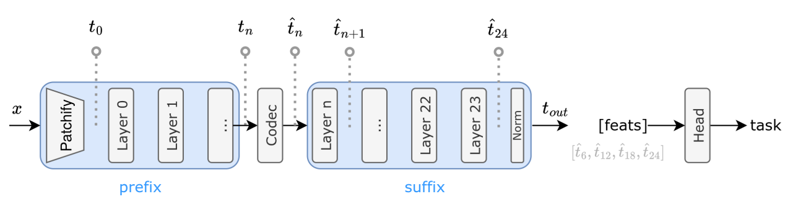

# DINOv3 CTC

本文给出 DINOv3 特征压缩在 **AI M2462 通用测试条件（CTC）** 下的配置约定，并整合底层统一架构（backbone / codec / head 三件套如何组合）的实现细节，可作为单一参考文档。

> 一句话：**模型 = backbone + codec + heads**，三者都是可插拔组件，通过 plan YAML 自由组合，不再为每种「backbone × 压缩方法 × 任务」组合单独写一个 Python 类。

## 1. 通用测试条件

此前提案中常混用 Layer、Block 和 Slot 来描述特征提取的位置。为统一表述，参考软件采用 Slot 表示特征位置。

具体来说，`Layer x` 与 `Block x` 均表示从 0 开始编号的 Transformer 计算模块。此前提案也常直接以 `Layer x` 指代该模块输出处的分割点。参考软件则采用 Slot 记法，将 `Block x` 的输出特征位置记为 `Slot (x+1)`。因此，提案中 Layer / Block 5、11、17、23 的输出位置，分别对应参考软件中的分割点 `slot6`、`slot12`、`slot18`、`slot24`。详细关系见[第 7 节](#7-backbone-与分割点slot)。

根据 AI M2462 的 CTC 讨论和 AI M2489 的 CTC 建议，通用测试条件选定如下：

三个任务均使用 DINOv3 `vitl16`（`model_size=large`、`patch_size=16`）。各任务的测试设置、当前提供的 Bypass 基线分割点及其他可选分割点如下：

| 任务 | 数据集 | 输入尺度与预处理 | 基线分割点 | 其他可选分割点 | 主要指标 |
|------|--------|------------------|------------|----------------|----------|
| 语义分割 | ADE20K 验证集 | 原生尺寸，padding 到 16 的整数倍 | `slot24`、`slot6` | `slot12`、`slot18` | mIoU |
| 深度估计 | NYUv2 测试集 | 原生尺寸，padding 到 16 的整数倍 | `slot24`、`slot6` | `slot12`、`slot18` | RMSE、AbsRel、a1 |
| 目标检测 | COCO val 1k | 保持宽高比缩放，目标短边 1024、长边不超过 1536，再 padding 到 16 的整数倍 | `slot6` | — | AP、AP50、AP75 |

图像重建任务的测试条件待定。

> 注意：CTC 评测取用的最后一层特征是 **norm 之前** 的特征。


## 2. 下载数据与权重

权重与数据集压缩包通过下载清单 `dinov3-ctc.manifest.txt` 一键拉取并按 sha256 校验（默认从 `https://medialab.sjtu.edu.cn/files/CoFAI-share/` 按相对路径下载）。在仓库根目录执行：

```bash
poetry run cofai-download examples/ctc/dinov3-ctc.manifest.txt
```

数据集以压缩包形式下载到 `data/`，目前需**手动解压**到对应位置：

```bash
unzip data/ADE20K.zip -d data/
unzip data/NYU_subset_for_training_depth_head.zip -d data/
unzip data/coco_val_1k.zip -d data/
```

解压后的最终目录结构如下：

```
CoFAI/
│
├─ data/                                  # 数据子集
│   ├─ ADEChallengeData2016/
│   │   ├─ images/
│   │   └─ annotations/
│   ├─ NYU/
│   │   ├─ train/  test/
│   │   └─ nyu_train.txt  nyu_test.txt
│   └─ coco_val_1k/
│       ├─ val2017/
│       ├─ annotations/instances_val2017.json
│       └─ coco_val_1k.txt
│
├─ weights/                               # 预训练权重
│   └─ dinov3/
│       ├─ backbone/
│       ├─ semseg_head/
│       ├─ dpt_head/
│       └─ det_head/
```

## 3. 运行测试

> Plan 文件通过 `${PROJECT_ROOT}` 引用权重/数据路径，运行前请先设置环境变量 `PROJECT_ROOT`（见项目根目录 README）。

通过统一评测引擎 `cofai-eval` 执行任一 plan，结果（bpp / bpfp / mIoU 或 RMSE 等）写入 `logs/<plan-name>/result.json`：

```bash
# ADE20K 语义分割（Bypass 基线，slot24）
CUDA_VISIBLE_DEVICES=0 poetry run cofai-eval \
  conf/plan/ade20k-val__dinov3-vitl16-slot24__Bypass__semseg.yaml

# NYUv2 深度估计（Bypass 基线，slot24）
CUDA_VISIBLE_DEVICES=0 poetry run cofai-eval \
  conf/plan/nyuv2-val__dinov3-vitl16-slot24__Bypass__depth.yaml

# ADE20K 语义分割（Bypass 基线，slot6）
CUDA_VISIBLE_DEVICES=0 poetry run cofai-eval \
  conf/plan/ade20k-val__dinov3-vitl16-slot6__Bypass__semseg.yaml

# NYUv2 深度估计（Bypass 基线，slot6）
CUDA_VISIBLE_DEVICES=0 poetry run cofai-eval \
  conf/plan/nyuv2-val__dinov3-vitl16-slot6__Bypass__depth.yaml

# COCO val 1k 检测（Bypass，slot6，short-side 1024，Plain-DETR）
CUDA_VISIBLE_DEVICES=0 poetry run cofai-eval \
  conf/plan/coco-val1k__dinov3-vitl16-slot6__Bypass__det.yaml
```

需要统计 **latent codec 复杂度**（参数量、编码/解码 FLOPs、codec 耗时）时，加上 `args.profile=true`；结果会写入 `result.json` 末尾的 `codec_*` 字段（`codec_params`、`codec_enc_flops`、`codec_dec_flops`、`codec_enc_time`、`codec_dec_time`）。`args.max_samples` 同样生效，不设则跑完整数据集后取平均。

```bash
CUDA_VISIBLE_DEVICES=0 poetry run cofai-eval \
  conf/plan/ade20k-val__dinov3-vitl16-slot24__Bypass__semseg.yaml \
  args.profile=true
```

以下为上述 Bypass plan 使用下载清单中权重的全量评测参考结果：ADE20K 验证集 2,000 张、NYUv2 测试集 654 张、COCO 子集 1,000 张。Bypass 不压缩，bpp 为 0；mIoU 和 AP 均以 0–1 表示。

| Plan | bpp | 指标 |
|------|-----|------|
| `ade20k-val__dinov3-vitl16-slot24__Bypass__semseg` | 0.0 | mIoU 0.5309 |
| `nyuv2-val__dinov3-vitl16-slot24__Bypass__depth` | 0.0 | RMSE 0.3476 |
| `ade20k-val__dinov3-vitl16-slot6__Bypass__semseg` | 0.0 | mIoU 0.5309 |
| `nyuv2-val__dinov3-vitl16-slot6__Bypass__depth` | 0.0 | RMSE 0.3476 |
| `coco-val1k__dinov3-vitl16-slot6__Bypass__det` | 0.0 | AP 0.5605 / AP50 0.7625 |

## 4. 统一架构总览

重构前，每一种「backbone × 压缩方法 × 任务」的组合都对应一个独立的 `CompressionModel` 子类（`Dinov2OrigClsVQFC`、`Dinov2TimmSegVQFC`、各种 `*Bypass` / `*SlideSeg*` …），导致 slide 逻辑、prefix 处理、bits 统计等代码到处复制。

重构后收敛为三层，所有可变性（用哪个 backbone、哪个 codec、哪个 head、哪个数据集、切在第几层）都下沉到 **plan YAML**：

| 层 | 角色 | 数量 | 位置 |
|----|------|------|------|
| **CodecModel** | 编排 backbone→codec→head 的流程，处理任务分发与码率统计 | 固定 2 个 | `cofai/models/base.py` |
| **Backbone** | 提取 / 重建 DINO 特征，定义切分点（slot） | timm 统一 | `cofai/backbone/timm.py` |
| **LatentCodec** | 真正的压缩组件，遵循统一 token 接口 | 固定一组 | `cofai/latent_codecs/` |

## 5. 模型组织：两个 CodecModel

均定义于 `cofai/models/base.py`。CTC 默认使用单窗口的 `DinoFeatureCodecModel`，由三个可插拔组件构成：

- **backbone**：缺省 `Dinov3TimmBackbone`，提供切分点（slot），负责 `encode` / `decode_*`。
- **codec**：缺省 `BypassLatentCodec`（即不压缩）。在切分点对编码器 token `(B, N, C)` 做压缩 / 解压缩，均位于 `cofai/latent_codecs/`。plan 简称与实际类名对应如下：

| 简称 | LatentCodec 类 | 压缩原理 |
|-----------|----------------|----------|
| `Bypass` | `BypassLatentCodec` | 不压缩，直通 |
| `VQFC` | `VQFeatureCodec` | 向量量化（码本） |
| `ORFC` | `OrthoRotationFeatureCodec` | 正交旋转 + 乘积量化 + rANS |
| `VTM` | `VtmLatentCodec` | 标准视频编码器（VVC/VTM）打包压缩 |
| `VTC` | `VisualTokenCodec` | 视觉 token 编码（可变码率） |
| `MPC` | `VbrVitUnionLatentCodec` | 可变码率 ViT union 熵模型 |
| `RFC` | `MLoREFeatureCodec` | MLoRE 多任务低秩专家特征编码 |

- **head**：下游任务预测头，支持 `cls` / `seg` / `semseg` / `depth` / `det` / `rae`（特征重建），由提供的 `heads` 决定。


### `DinoSlideFeatureCodecModel`（滑窗子类，CTC 一般不用）

继承 `DinoFeatureCodecModel`，用于大图分割：把图切成重叠 crop，逐 crop 编码压缩，再把每个 crop 的重建特征融合成全分辨率 logits。滑窗逻辑（`slide_encode` / `slide_decode_seg`）内置在模型里，任何暴露 `encode` / `decode_seg` 的 backbone 都能用。`slide_codec_mode`：

- `per_crop`（默认）—— 每个 crop 单独调用一次 codec。
- `stacked` —— 所有 crop 堆进 batch 维，一次 codec 调用，例如使用标准编码器（VTM）。

## 6. LatentCodec 接口契约

所有 codec 都是 `nn.Module`，对**编码器 token 张量 `(B, N, C)`** 操作，实现以下三个方法（`token_res` 给空间型 codec 用，`qp` 给可变码率 codec 用）：

```python
forward(h, token_res, qp)    -> {"h_hat", "likelihoods"}               # 训练 / 在线：压缩+重建一步到位
compress(h, token_res, qp)   -> {"strings", "pstate"} # 仅编码
decompress(strings, pstate)  -> {"h_hat"}                    # 仅解码
```

## 7. Backbone 与分割点（slot）

backbone 统一用 timm 实现：`Dinov2TimmBackbone` / `Dinov3TimmBackbone`（`cofai/backbone/timm.py`）。backbone size 由 `model_size` + `patch_size` 决定，在 plan 文件名里写作 `vitl16`、`vitg14`、`vitb16` 等。



`Layer x` 与 `Block x` 是同一个 Transformer block 的两种称呼，编号从 0 开始。slot 则表示 block 之间的特征边界：`Block x` 的输入特征 `t_x` 位于 `slot x`，输出特征 `t_(x+1)` 位于 `slot(x+1)`，即

\[ t_{x+1} = \mathrm{Block}_x(t_x) \]

- 参考软件统一用 slot 表示分割点。`slotNN` 对应配置 `slot: NN`：编码侧运行 `blocks[:NN]`，解码侧从 `blocks[NN:]` 继续运行。当前 CTC 配置使用正整数 slot。
- 文件名中的 `slotNNn` 表示在 `slotNN` 处额外经过一次 `norm` 的特征，分割点编号仍为 NN。

据此，CTC 的分割点映射为：

| 参考软件分割点 | 对应的 Layer / Block 输出 |
|----------------|---------------------------|
| `slot24` | Layer 23 / Block 23 |
| `slot18` | Layer 17 / Block 17 |
| `slot12` | Layer 11 / Block 11 |
| `slot6` | Layer 5 / Block 5 |

例如，`slot6` 将编码侧与解码侧分为前 6 个 block 和后 18 个 block，对应 Block 5 的输出边界。

分割和深度估计的任务头使用 `slot24` 处的特征（`n_last_blocks: 1`），在 `slot6` 与 `slot24` 分割时共用同一套任务头权重；检测任务头使用 `slot6`、`slot12`、`slot18`、`slot24` 处的四层中间特征。任务头特征选择参数 `n_last_blocks` 中的列表仍按从 0 开始的 block 索引填写，因此检测配置为 `[5, 11, 17, 23]`。

## 8. 下游任务头与权重

CTC 当前落地的任务头（见 `conf/heads/dinov3_head.yaml`）：

| 任务 | 数据集 | head 类型 | 预训练权重 |
|------|--------|-----------|------------|
| 语义分割 | ADE20K | `Dinov3SegmentationHead`（150 类，linear head） | `weights/dinov3/semseg_head/dinov3_vitl16_semseg_ade20k_linear_head.pth` |
| 深度估计 | NYUv2 | `Dinov3DepthHead`（linear head，depth 0.001–10.0） | `weights/dinov3/dpt_head/dinov3_vitl16_depth_nyuv2_linear_head.pth` |
| 目标检测 | COCO val 1k | `Dinov3PlainDETRHead`（四层中间特征 + Plain-DETR） | `weights/dinov3/det_head/plain_detr_dinov3_vitl16_checkpoint_best.pth` |

图像重建任务头待定。

## 9. Plan 组合与命名

用于参考的 plan 放在 `conf/plan/` 目录下，一般是 Bypass 基线。
各个提案的 plan 放在 `examples/proposal-xxx/plan/` 目录下。

文件名用 `__` 分四段：

```
<dataset>__<backbone-feature>__<codec>__<head>.yaml
```

字段含义：

- `dataset`：数据子集（`ade20k-val`、`nyuv2-val`、`imagenet-sel500` …）。
- `backbone-feature`：`<arch>-<size>[-reg4][-slide]-slot<NN>[n]`，`reg4` 表示带 4 个 register token，`slide` 表示滑窗模型。
- `codec`：`Bypass` / `VQFC` / `ORFC` / `VTM` / `VTC` / `MPC` / `RFC`，可变码率加 `-vbr`。
- `head`：`cls` / `semseg` / `depth` / `rae` 等，`-lastN` 表示用最后 N 个 block 的特征（N≠1 时标注）。

本 CTC 场景的 Bypass 基线（不压缩）示例：

```
ade20k-val__dinov3-vitl16-slot24__Bypass__semseg.yaml
nyuv2-val__dinov3-vitl16-slot24__Bypass__depth.yaml
ade20k-val__dinov3-vitl16-slot6__Bypass__semseg.yaml
nyuv2-val__dinov3-vitl16-slot6__Bypass__depth.yaml
coco-val1k__dinov3-vitl16-slot6__Bypass__det.yaml
```

plan 内部结构（节选）：

```yaml
model:
  type: DinoFeatureCodecModel                    # 或 DinoSlideFeatureCodecModel
  dino_backbone:
    type: cofai.backbone.Dinov3TimmBackbone
    model_size: large
    patch_size: 16
    slot: 24
  dino_codec:
    type: cofai.latent_codecs.BypassLatentCodec  # 基线不压缩
  heads:
    semseg: ${heads.ade20k_seg_large_last1}
```

DINOv2 的成熟范例可参考 `conf/dinov2-plan/`，例如：

```
conf/dinov2-plan/ade20k-val__dinov2-vitb16-reg4-slot09__Bypass__semseg-last4.yaml
conf/dinov2-plan/imagenet-sel500__dinov2-vitl14-slot11__ORFC__cls.yaml
```

## 10. 增加新组合的步骤

得益于归约，新增一种实验通常**无需写 Python**：

1. 选 CodecModel（单窗口 `DinoFeatureCodecModel` / 滑窗 `DinoSlideFeatureCodecModel`）。
2. 选 backbone + slot。
3. 选 LatentCodec 并填参数；若需新压缩算法，新增一个遵循第 6 节接口的 `XxxFeatureCodec` 并在 `cofai/latent_codecs/__init__.py` 导出。
4. 选 head 与数据集。
5. 按第 9 节命名写 plan，丢进对应 plan 目录，用 `cofai-eval` 跑。
